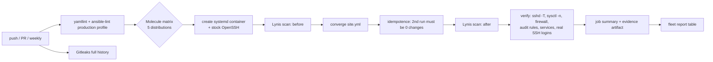

# ansible-linux-hardening

[](https://github.com/ahmedelgmal310/ansible-linux-hardening/actions/workflows/ci.yml)
[](LICENSE)

Ansible roles that take a freshly provisioned Ubuntu, Debian, Rocky or AlmaLinux
server to a CIS-aligned baseline: key-only SSH with modern crypto, a default-deny
firewall, kernel network hardening, auditd with the CIS rule set, fail2ban and
metrics. Every push converges all five distributions in Molecule, runs the
playbook a second time to prove idempotence, verifies the result from the
outside (including real SSH logins), and scores each host with Lynis before
and after.

## Results

From CI run [40452919082](https://github.com/ahmedelgmal310/ansible-linux-hardening/actions/runs/40452919082)
on `main`:

| Distribution | Changes on first run | Changes on second run | Verify tasks passed | Lynis before | Lynis after |
| --- | ---: | ---: | ---: | ---: | ---: |
| Ubuntu 24.04.5 LTS | 54 | **0** | 30 / 30 | 62 | **83** |
| Debian 12 | 52 | **0** | 30 / 30 | 62 | **83** |
| Debian 13 | 52 | **0** | 30 / 30 | 63 | **83** |
| Rocky Linux 9.8 | 56 | **0** | 30 / 30 | 63 | **82** |
| AlmaLinux 9.8 | 56 | **0** | 30 / 30 | 62 | **82** |

- **Idempotence:** 0 changed tasks on the second run on 5 of 5 distributions.
- **Benchmark:** Lynis hardening index rises by 19 to 21 points on every
  distribution (62-63 to 82-83). Lynis suggestions drop by roughly half
  (for example 41 to 22 on Ubuntu 24.04).
- **Controls:** 92 controls across 8 roles, mapped to CIS IDs in
  [docs/controls.md](docs/controls.md).

The "before" scan runs on the stock distribution image plus the stock OpenSSH
server, which is what a newly provisioned server looks like. Each job's summary
and the `results-<distro>` artifact contain the full Lynis reports and Ansible
logs.

### Why Lynis and not OpenSCAP

OpenSCAP's SCAP Security Guide profiles evaluate bootloader, partition, and
kernel audit state that a container does not have, so in Molecule most rules
come back `notapplicable` or `error`, and the score says more about the
container than the hardening. Lynis runs from a pinned, commit-verified git
checkout inside the container, needs nothing from the package manager, and
gives a comparable index on all five distributions. On real VMs, running the
SSG CIS profile against the same roles is a reasonable next step.

## What it hardens

| Role | What it does |
| --- | --- |
| `base` | Removes legacy clients (telnet, rsh, talk, NIS, ftp), sets the time zone, chrony as a client-only NTP daemon, unattended security updates (`unattended-upgrades` / `dnf-automatic`), persistent and size-bounded journald, login banners, EPEL on EL9 |
| `users` | Admin users from variables with exclusively managed SSH keys, an SSH access group, per-user sudo drop-ins validated by `visudo` (passwordless only where `sudo_nopasswd: true`), `use_pty` and sudo logging, root password locked, password aging, umask 027, pwquality |
| `ssh_hardening` | Full `sshd_config` template: no root login, no password or keyboard-interactive auth, `AllowGroups`, AEAD/CTR ciphers, ETM MACs, post-quantum and Curve25519 KEX (filtered by what the installed OpenSSH supports), idle timeouts, banner, no forwarding. Validated with `sshd -t` before the file is written and again before the restart handler |
| `firewall` | ufw on Debian/Ubuntu, firewalld on EL9. Default deny inbound, explicit allowlist with optional source CIDR, allow rules applied before the policy flips |
| `kernel_hardening` | CIS 3.3 network sysctls (forwarding, redirects, source routing, rp_filter, syncookies, martians, IPv6 RA), ASLR, ptrace scope, core dumps off, kernel pointer and dmesg restrictions, blacklist of unused filesystems, USB storage and rare protocols |
| `audit` | auditd with the CIS 6.2.3 rule set (identity, sudoers, time, network, perms, mounts, deletes, modules, sessions, MAC policy) and immutable mode, log retention settings |
| `fail2ban` | sshd jail on the systemd journal with incremental ban times, banning through ufw or firewalld |
| `node_exporter` | Prometheus node_exporter from the upstream release, SHA-256 verified, running under a dedicated user in a sandboxed systemd unit |

Every role has `meta/argument_specs.yml`, so a typo or a wrong type in an
inventory variable fails before any task runs.

## Supported distributions

| Distribution | Version | Firewall | Tested in CI |
| --- | --- | --- | --- |
| Ubuntu | 24.04 LTS | ufw | yes |
| Debian | 12 (bookworm) | ufw | yes |
| Debian | 13 (trixie) | ufw | yes |
| Rocky Linux | 9 | firewalld | yes |
| AlmaLinux | 9 | firewalld | yes |

`site.yml` refuses to run against anything else.

## How CI proves it



The verify playbook ([molecule/default/verify.yml](molecule/default/verify.yml))
checks the running system, not just files:

- `sshd -T` effective values for 22 settings, plus real logins from the runner
  with a throwaway key created during the job: an admin can log in; a user
  outside `AllowGroups` with a valid key is rejected; root is rejected; the server
  offers `publickey` only; a CBC cipher handshake fails; `sudo -n` is refused for
  a password-sudo user and allowed for the one user configured for it.
- Every sysctl read back with `sysctl -n` and compared with the role defaults.
- `ufw status verbose` / `firewall-cmd` default policy and allowlist.
- Compiled audit rules contain all 15 CIS keys and `-e 2`.
- sshd, chrony, fail2ban and node_exporter running; fail2ban sshd jail loaded;
  `/metrics` answering.

Pipeline hygiene: every action is pinned to a full commit SHA, the Gitleaks
image is pinned by digest, the workflow token is `contents: read`, Python tools
and collections are pinned in [requirements.txt](requirements.txt) and
[requirements.yml](requirements.yml), and Dependabot (with a 14 day cooldown)
keeps them current.

## Usage

```bash
python -m venv .venv && . .venv/bin/activate
pip install -r requirements.txt
ansible-galaxy collection install -r requirements.yml

# 1. Put real public keys and your management CIDR in the inventory
$EDITOR inventories/example/group_vars/all.yml

# 2. Preview, canary, then roll out in batches
ansible-playbook site.yml --check --diff --limit canary
ansible-playbook site.yml --limit canary
ansible-playbook site.yml -e rollout_serial=10% -e rollout_max_fail_percentage=0
```

Read [docs/rollout.md](docs/rollout.md) before the first run: SSH, firewall and
account changes can lock you out if keys or allowlists are wrong.

Run the tests locally (Docker required):

```bash
MOLECULE_IMAGE=mirror.gcr.io/library/debian:12 molecule test
```

## Known limits

- **auditd in containers:** the kernel only accepts audit rules from the initial
  PID namespace, so CI checks the compiled rule file rather than `auditctl -l`.
  The verify playbook runs `auditctl -l` automatically on VMs.
- **Kernel sysctls** that are not network-namespaced (`kernel.*`, `fs.*`) are
  applied to the CI runner's kernel during tests. Harmless on ephemeral runners.
- **EL9 test image:** `/etc/shadow` is made root-readable (0400) in the test
  image only, because the setuid PAM helper cannot read the stock 0000 file
  inside this container runtime and every `sudo` call fails. Real hosts keep the
  distribution default.
- Bootloader settings, separate partitions and AIDE file integrity are out of
  scope (image build or provisioning concerns).

## Layout

```
site.yml                     entry point (serial batches, tags per control)
inventories/example/         example inventory and group_vars
roles/<role>/                defaults, tasks, handlers, templates, meta/argument_specs.yml
molecule/default/            Dockerfile, prepare, converge, verify
scripts/ci/                  Lynis scan and result summary used by CI
docs/controls.md             every control mapped to a CIS ID
docs/rollout.md              check mode, canary, batches, rollback
```

## License

[MIT](LICENSE)
